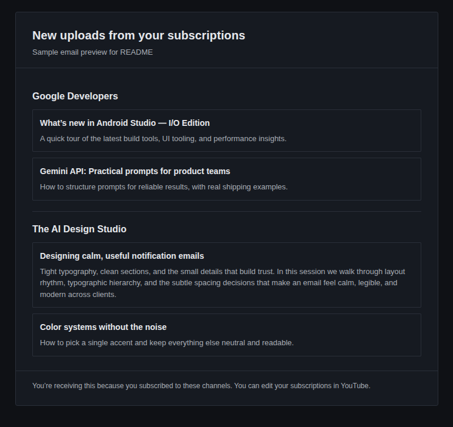

# Subscribed YouTube channels' new videos reminder

This GAS project is designed to send reminders to subscribed YouTube channels when they upload new videos. It
utilizes the Google Apps Script platform to automate the process and send notifications via email.



# To use

1. Clone this repository

2. Run below:

```bash
npm install
npm run login ## You need to login your Google account
npm run push
```

3. Then, you can find the script in your Google apps script page.

4. Go to the script editor and make new HTML file named "template"

5. Copy html code from this repository's "src/template.html" and paste it into the HTML file in GAS editor.

6. Set script property `email_address` at GAS project setting page.

_example: ["example@domain.com"]_

↑need to be array of string

7. Back to editor and click [Add a service] button on left side panel and select "YouTube Data API"

8. Click [Run] button.

opusionaly, you can add trigger in GAS project trigger page.

## Performance & Quota

This script uses the YouTube Data API efficiently:

- **Quota cost per daily run:** ~140 units first run, ~75 units warm cache (vs 7,300 before optimization)
- **Daily quota available:** 10,000 units (default)
- **Maximum subscriptions:** 1,000+ channels (before quota concerns)
- **Cache strategy:** Uploads playlist IDs cached for up to 6 hours (CacheService max TTL)

### Quota Monitoring

Monitor your daily quota usage:

1. Go to [Google Cloud Console](https://console.cloud.google.com)
2. Select your project
3. Navigate to APIs & Services → Quotas
4. Filter for "YouTube Data API v3"
5. Check daily quota used (should be ~140 units first run, then ~75 units)

If quota usage exceeds 5,000 units/day, request quota increase via
[YouTube API quota form](https://support.google.com/youtube/contact/yt_api_form).

### Troubleshooting

**Q: Script runs but no emails sent**

- Check GAS logs for errors
- Verify subscribed channels exist
- Verify script property `email_addresses` is set

**Q: Seeing cache-related errors**

- Cache is per-user in GAS (if using `getUserCache`)
- Run script as same Google account to benefit from caching
- Clear cache: GAS editor → Run → clearCache() (optional custom function)

**Q: Quota still high after deployment**

- Verify you're running updated code (check GAS editor timestamps)
- Check for multiple trigger executions (Triggers tab)
- First run caches playlist IDs (subsequent runs cheaper)
- Cache TTL is capped at 6 hours; values above are clamped

# Used template

Thank to [template repository](https://github.com/iansan5653/gas-ts-template)
